# Hướng dẫn sử dụng ReqSentinel

Tài liệu dành cho người dùng web: Business Analyst (BA), Product Owner, tester và quản trị viên.
Các tên nút, tab và nhãn trong tài liệu khớp với giao diện tiếng Việt.

## Mục lục

1. [Giới thiệu](#1-giới-thiệu)
2. [Bắt đầu sử dụng](#2-bắt-đầu-sử-dụng)
3. [Dự án và thành viên](#3-dự-án-và-thành-viên)
4. [Nhập yêu cầu](#4-nhập-yêu-cầu)
5. [Chạy phân tích](#5-chạy-phân-tích)
6. [Xử lý xung đột](#6-xử-lý-xung-đột)
7. [Lần chạy, so sánh và lịch sử](#7-lần-chạy-so-sánh-và-lịch-sử)
8. [Báo cáo](#8-báo-cáo)
9. [Thông báo](#9-thông-báo)
10. [Quản trị hệ thống](#10-quản-trị-hệ-thống-chỉ-quản-trị-viên)
11. [Câu hỏi thường gặp](#11-câu-hỏi-thường-gặp)

---

## 1. Giới thiệu

ReqSentinel giúp BA phát hiện **xung đột giữa yêu cầu nghiệp vụ và ma trận phân quyền**. Bạn nhập:

- **User story** (US) và **tiêu chí chấp nhận** (AC), viết bằng tiếng Anh theo mẫu *As a …, I want to … so that …*;
- **Ma trận phân quyền** (Permission Matrix, PM): mỗi dòng gồm vai trò, hành động, tài nguyên, hiệu lực (Allow/Deny), phạm vi và điều kiện.

Hệ thống đọc từng user story, trích ra *ai được làm gì trên cái gì*, đối chiếu với ma trận và báo 5 loại xung đột:

| Loại xung đột | Ý nghĩa | Ví dụ |
|---|---|---|
| **Thiếu quyền** | US/AC cần một quyền mà ma trận không có dòng nào khớp | US: Administrator xóa người dùng — PM chỉ cho Support Staff xóa |
| **Xung đột hành động** | Cùng vai trò và tài nguyên nhưng hành động khác nhau | US: *publish* danh sách — PM chỉ cho *draft* |
| **Xung đột hiệu lực** | US cần quyền nhưng PM đặt **Deny** (hoặc ngược lại) | US: khách xem danh mục sản phẩm — PM: Guest · view · Product Catalog = Deny |
| **Xung đột phạm vi** | Phạm vi trong US khác PM (`own` / `assigned` / `all`) | US: nhân viên xem khách hàng *được giao* — PM cấp phạm vi `all` |
| **Xung đột điều kiện** | PM có điều kiện mà US/AC không nhắc tới (hoặc ngược lại) | PM: cập nhật mô tả sản phẩm cần Product Manager phê duyệt — US không nêu |

Kết quả không có xung đột được ghi là **Bình thường** / **Nhất quán**.

### Vai trò

Có hai tầng vai trò:

- **Vai trò hệ thống**: **quản trị** (quản lý người dùng, xem nhật ký, có quyền chủ sở hữu trên mọi dự án) và **người dùng**.
- **Vai trò trong dự án**: mỗi thành viên có một trong ba vai trò sau.

| Thao tác | Người xem | Biên tập | Chủ sở hữu |
|---|:-:|:-:|:-:|
| Xem dự án, kết quả, báo cáo; bình luận xung đột | ✓ | ✓ | ✓ |
| Sửa user story, ma trận, từ điển; nhập Excel; chạy phân tích; xử lý và giao xung đột | | ✓ | ✓ |
| Mời, đổi vai trò, gỡ thành viên; đổi tên, xóa dự án | | | ✓ |

Một dự án luôn phải còn ít nhất một chủ sở hữu.

---

## 2. Bắt đầu sử dụng

### 2.1. Đăng nhập và tạo tài khoản

Mở địa chỉ hệ thống, nhập **Email** và **Mật khẩu** rồi bấm **Đăng nhập**. Chưa có tài khoản thì chọn tab **Tạo tài khoản**,
nhập họ tên, email và mật khẩu (tối thiểu 8 ký tự).

Góc trên của khung đăng nhập có nút chọn ngôn ngữ (VI/EN/JA) và nút chuyển giao diện sáng/tối.

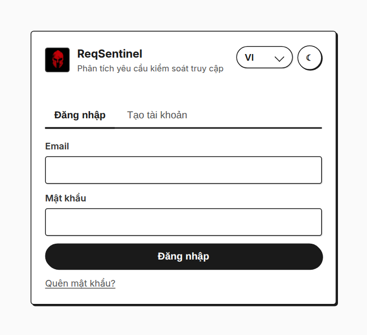

*Hình 1. Màn hình đăng nhập*

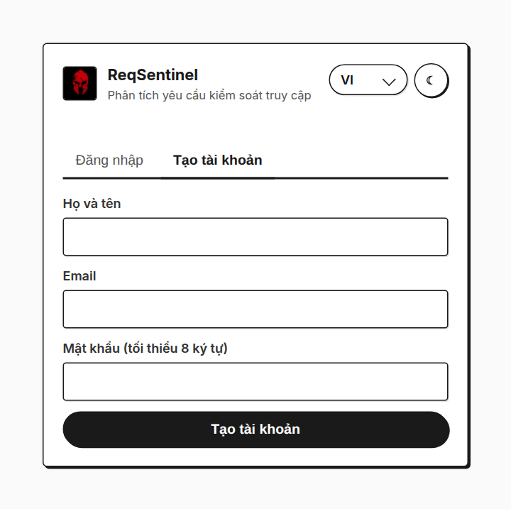

*Hình 2. Tab Tạo tài khoản*

> Đăng nhập sai quá 10 lần trong 15 phút sẽ bị tạm chặn; hãy chờ rồi thử lại.
> Nếu quản trị viên tắt chức năng tự đăng ký, tab Tạo tài khoản sẽ báo lỗi — hãy nhờ quản trị viên tạo tài khoản.

### 2.2. Quên mật khẩu

Bấm **Quên mật khẩu?**, nhập email và bấm **Gửi liên kết đặt lại**. Hệ thống gửi email chứa liên kết đặt mật khẩu mới,
**có hiệu lực 30 phút**. Mở liên kết, nhập mật khẩu mới hai lần và bấm **Đổi mật khẩu**.

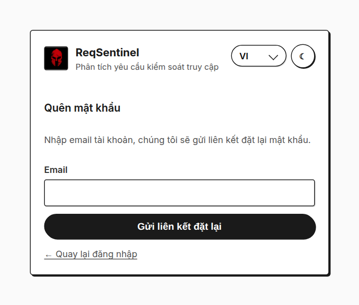

*Hình 3. Màn hình Quên mật khẩu*

### 2.3. Menu tài khoản

Sau khi đăng nhập, góc phải thanh trên cùng có **chuông thông báo** và **ảnh đại diện** (chữ viết tắt tên bạn).
Bấm vào ảnh đại diện để mở menu tài khoản:

- **Hồ sơ**: mở trang hồ sơ cá nhân;
- **Ngôn ngữ**: VI / EN / JA;
- **Giao diện**: Sáng / Tối;
- dòng trạng thái hệ thống (chấm xanh là mọi dịch vụ hoạt động bình thường) kèm số phiên bản;
- **Đăng xuất**.

Khi dịch vụ phân tích hoặc API gặp sự cố, ảnh đại diện hiện thêm một chấm đỏ.

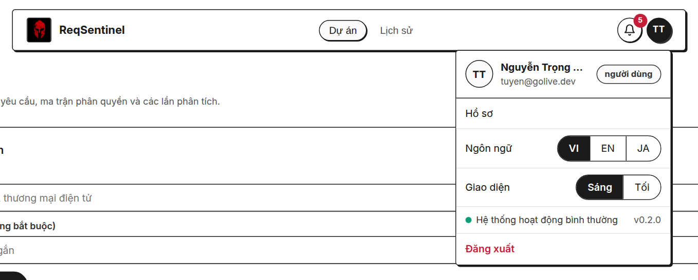

*Hình 4. Menu tài khoản*

### 2.4. Hồ sơ cá nhân

Trang **Hồ sơ** gồm ba phần:

- **Thông tin cá nhân**: họ tên, số điện thoại, chức danh, tổ chức, giới thiệu (email không đổi được). Bấm **Lưu thay đổi**.
- **Tùy chọn**: ngôn ngữ và giao diện. Tùy chọn được lưu vào tài khoản nên áp dụng trên mọi thiết bị; email hệ thống gửi cho bạn cũng dùng ngôn ngữ này.
- **Đổi mật khẩu**: nhập mật khẩu hiện tại, mật khẩu mới và nhập lại.

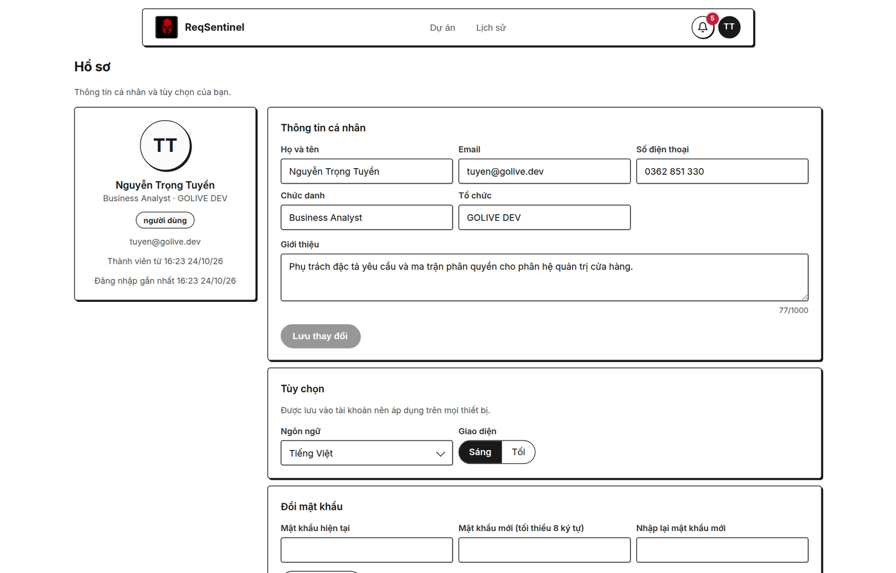

*Hình 5. Trang Hồ sơ*

Ví dụ giao diện tối và giao diện tiếng Nhật:

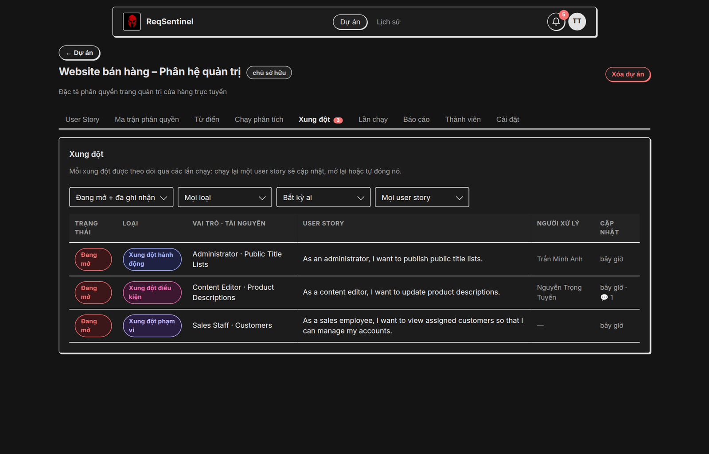

*Hình 6. Bảng xung đột ở giao diện tối*

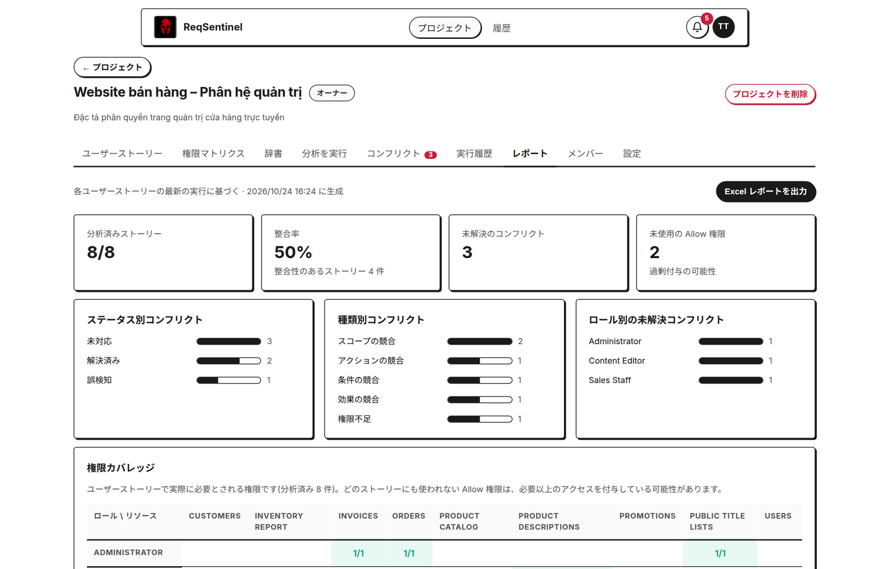

*Hình 7. Trang báo cáo bằng tiếng Nhật*

---

## 3. Dự án và thành viên

### 3.1. Tạo và xóa dự án

Trang **Dự án** liệt kê các dự án bạn tham gia, kèm số user story, số dòng PM, số lần chạy và số xung đột đang mở.
Ở khung **Tạo dự án**, nhập **Tên** (bắt buộc) và **Mô tả**, bấm **Tạo dự án** — bạn trở thành chủ sở hữu.
Bấm vào thẻ dự án để mở. Nút **Xóa** (chỉ chủ sở hữu) xóa dự án cùng toàn bộ dữ liệu liên quan.

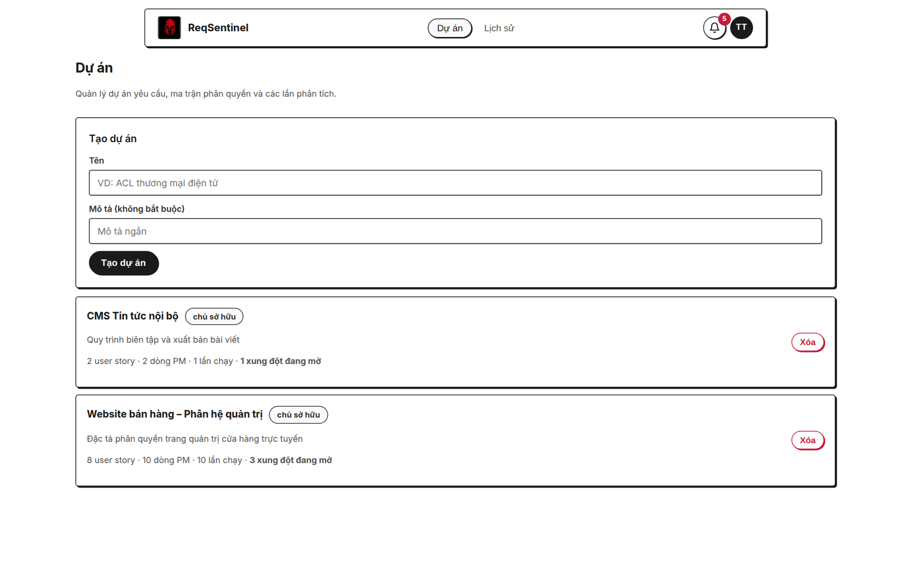

*Hình 8. Trang Dự án*

Trong một dự án, các chức năng nằm ở các tab: **User Story**, **Ma trận phân quyền**, **Từ điển**, **Chạy phân tích**,
**Xung đột**, **Lần chạy**, **Báo cáo**, **Thành viên**, **Cài đặt**.

### 3.2. Cài đặt dự án

Tab **Cài đặt** (chủ sở hữu) cho đổi tên và mô tả dự án. Bấm **Lưu thay đổi**.

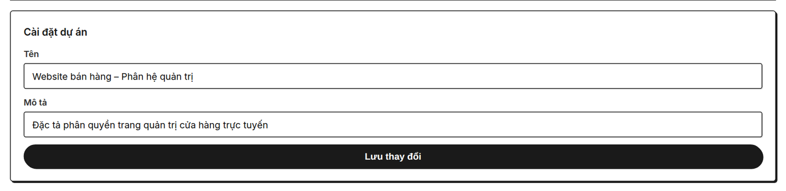

*Hình 9. Tab Cài đặt*

### 3.3. Thành viên và lời mời

Tab **Thành viên** hiển thị danh sách thành viên, vai trò và ngày tham gia.

- **Mời qua email** (chủ sở hữu): nhập email, chọn vai trò, bấm **Gửi lời mời**. Người được mời nhận email có liên kết tham gia;
  nếu chưa có tài khoản họ có thể đăng ký ngay từ liên kết đó (bằng đúng email được mời).
- **Lời mời đang chờ**: xem người mời, ngày hết hạn; bấm **Thu hồi** để liên kết trong email hết hiệu lực.
- **Đổi vai trò**: chọn vai trò mới ở cột Vai trò rồi xác nhận.
- **Gỡ**: gỡ thành viên khỏi dự án. Thành viên tự rời dự án bằng nút **Rời** trên dòng của mình.

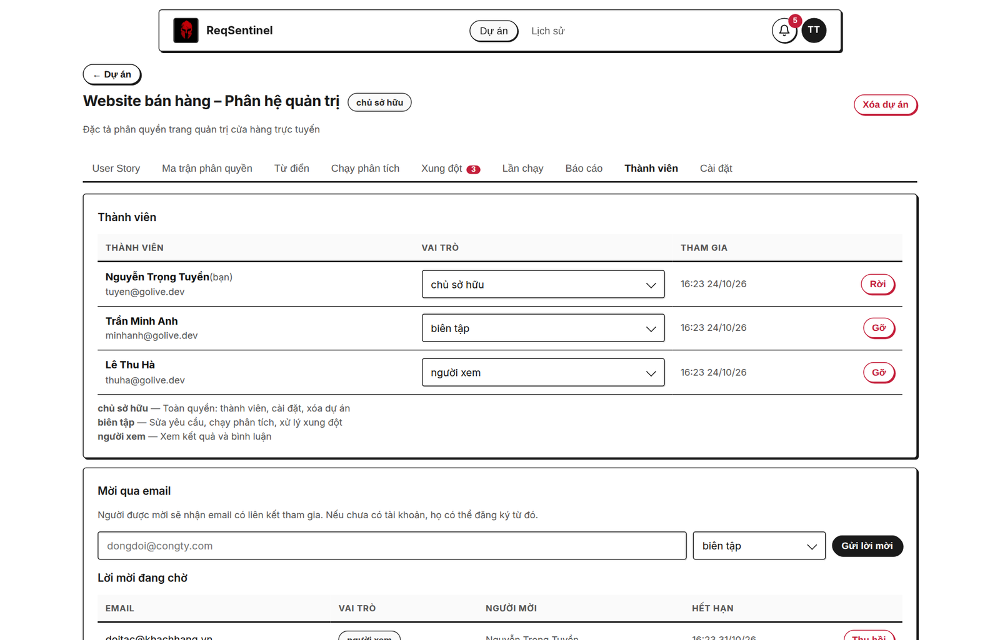

*Hình 10. Tab Thành viên*

Email mời có nút **Chấp nhận lời mời**. Lời mời **hết hạn sau 7 ngày**.

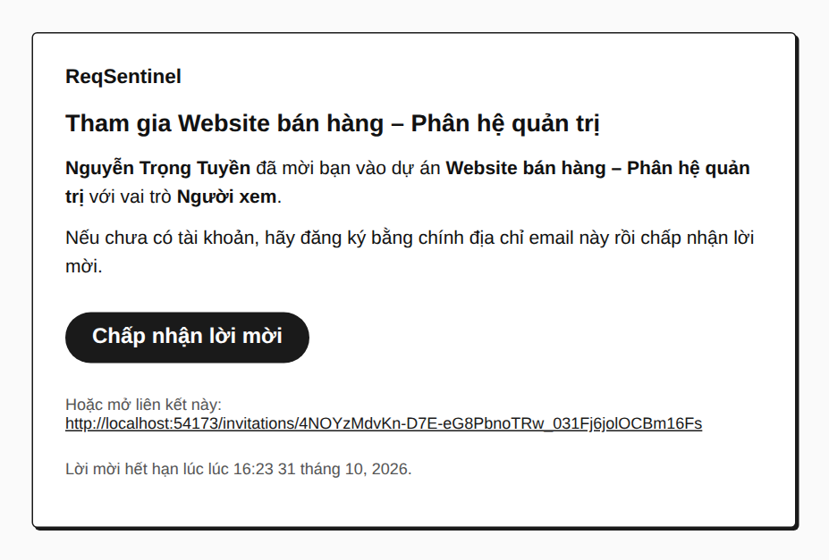

*Hình 11. Email mời tham gia dự án*

Khi mở liên kết, trang lời mời cho biết tên dự án, người mời và vai trò. Chưa đăng nhập thì bấm **Đăng nhập để chấp nhận**
hoặc **Tạo tài khoản**; đã đăng nhập thì bấm **Chấp nhận lời mời**. Nếu bạn đang đăng nhập bằng email khác email được mời,
trang sẽ báo và cho đăng nhập bằng tài khoản khác.

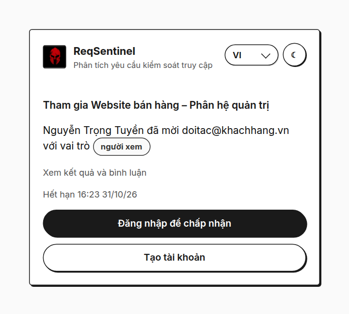

*Hình 12. Trang nhận lời mời*

---

## 4. Nhập yêu cầu

### 4.1. User story và tiêu chí chấp nhận

Tab **User Story** liệt kê user story và AC của dự án.

- **Thêm user story**: nhập nội dung, mỗi tiêu chí chấp nhận một dòng, bấm **Thêm user story**.
- **Sửa** / **Xóa** trên từng dòng. Xóa user story cũng xóa các xung đột của nó.
- **Tải mẫu Excel**: tải file mẫu có hai sheet `UserStories` (cột `content`, `acceptance_criteria` — nhiều AC cách nhau bằng dấu `;`)
  và `PermissionMatrix` (cột `role`, `action`, `resource`, `effect`, `scope`, `condition`).
- **Nhập Excel**: chọn file `.xlsx` (tối đa 10 MB). Dữ liệu được **thêm vào** dự án (không thay dữ liệu cũ);
  hệ thống báo số US, AC, PM đã nhập và số cảnh báo nếu có dòng bị bỏ qua.

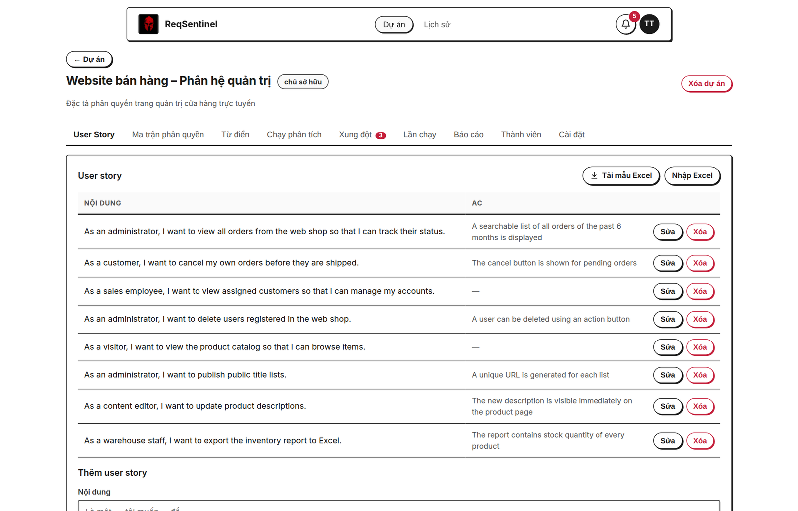

*Hình 13. Tab User Story*

### 4.2. Ma trận phân quyền

Tab **Ma trận phân quyền** gồm các cột **Vai trò**, **Hành động**, **Tài nguyên**, **Hiệu lực** (Allow/Deny), **Phạm vi**
(`own` / `assigned` / `all`) và **Điều kiện**. Vai trò, Hành động, Tài nguyên là bắt buộc.
Thêm dòng ở khung **Thêm dòng** → **Thêm dòng PM**; sửa hoặc xóa trên từng dòng.

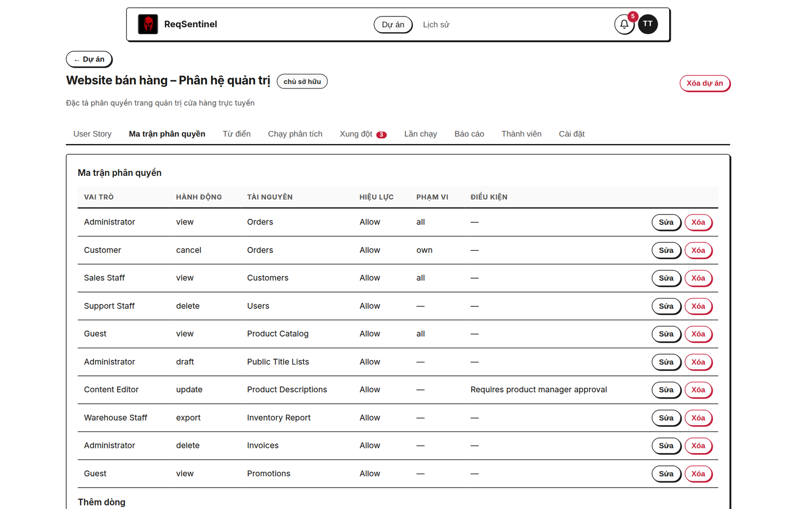

*Hình 14. Tab Ma trận phân quyền*

### 4.3. Phiên bản ma trận

Phần **Phiên bản** (cuối tab Ma trận phân quyền) lưu lại các trạng thái của ma trận:

- Hệ thống **tự lưu một phiên bản trước mỗi lần phân tích** nếu ma trận đã thay đổi;
- Bạn có thể lưu thủ công: nhập nhãn (ví dụ *v1 đã chốt*) và bấm **Lưu phiên bản**;
- **So với hiện tại**: xem các dòng thêm/bớt/thay đổi giữa phiên bản đó và ma trận hiện tại;
- **Khôi phục**: thay ma trận hiện tại bằng phiên bản đã chọn. Trạng thái hiện tại được lưu thành phiên bản mới trước, nên không mất dữ liệu.

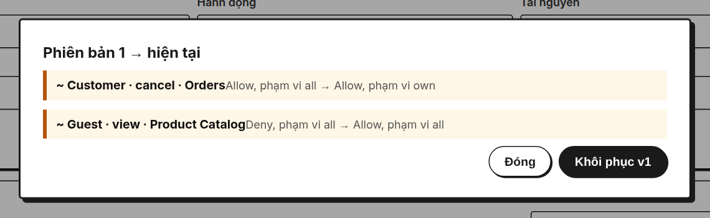

*Hình 15. So sánh phiên bản 1 với ma trận hiện tại*

### 4.4. Từ điển thuật ngữ

Cùng một vai trò có thể được viết nhiều cách ("Sales employee", "Salesperson", "Sales Staff"). Tab **Từ điển** cho khai báo
**tên chuẩn** và **từ đồng nghĩa** theo loại (vai trò / tài nguyên / hành động). Trước mỗi lần phân tích, từ đồng nghĩa trong US, AC
và ma trận được thay bằng tên chuẩn, giúp so khớp chính xác hơn.

Phần **Chưa có trong từ điển** gợi ý các giá trị đang dùng trong ma trận mà chưa có mục từ điển; bấm **+ thêm** để thêm nhanh.

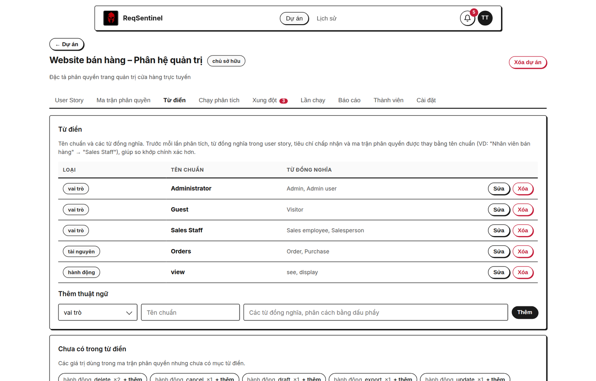

*Hình 16. Tab Từ điển*

---

## 5. Chạy phân tích

Tab **Chạy phân tích** có hai cách (cần vai trò biên tập hoặc chủ sở hữu; người xem chỉ xem được kết quả).

### 5.1. Phân tích toàn bộ dự án

Bấm **Phân tích tất cả user story**. Việc phân tích chạy ở nền, bạn có thể chuyển sang tab khác; bảng bên dưới cập nhật
trạng thái theo thời gian thực (đang chờ → đang chạy → hoàn tất), số user story đã xử lý, số lỗi và phiên bản mô hình.
Khi xong, bạn nhận một thông báo trên chuông. Mỗi dự án chỉ chạy một lượt phân tích toàn bộ tại một thời điểm.

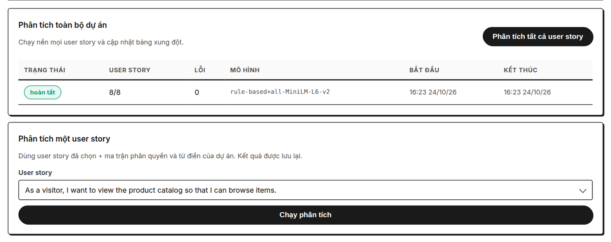

*Hình 17. Phân tích toàn bộ dự án và tiến độ*

### 5.2. Phân tích một user story

Ở khung **Phân tích một user story**, chọn user story rồi bấm **Chạy phân tích**. Kết quả gồm:

- nhãn **Nhất quán** hoặc **Phát hiện xung đột**, số xung đột và phiên bản mô hình;
- danh sách **Xung đột**: loại, độ tin cậy, giải thích, bằng chứng từ US/AC và từ PM; liên kết **Mở trong bảng xung đột →**;
- **Trích xuất**: bộ (vai trò · hành động · tài nguyên · phạm vi) hệ thống đọc được từ user story;
- **Tóm tắt** dạng văn bản.

Mọi lần chạy đều được lưu và cập nhật bảng xung đột.

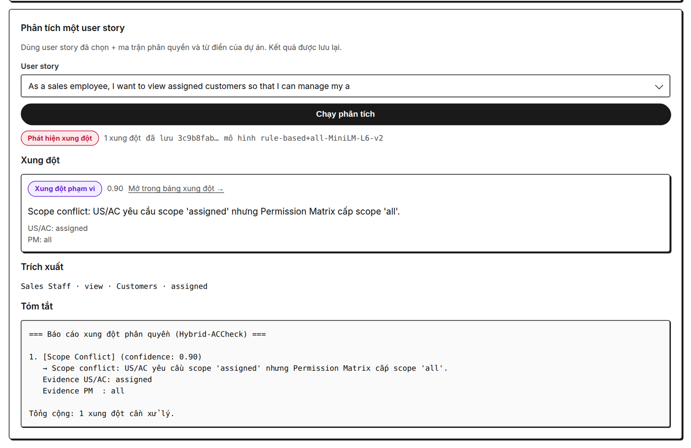

*Hình 18. Kết quả phân tích một user story có xung đột phạm vi*

---

## 6. Xử lý xung đột

### 6.1. Bảng xung đột

Tab **Xung đột** gom mọi xung đột của dự án. Mỗi xung đột được theo dõi qua các lần chạy, không bị nhân bản khi chạy lại.
Bộ lọc phía trên: trạng thái (**Đang mở + đã ghi nhận**, **Mọi trạng thái** hoặc từng trạng thái), loại xung đột,
người xử lý (**Bất kỳ ai**, **Giao cho tôi**) và user story. Bấm vào một dòng để mở chi tiết.

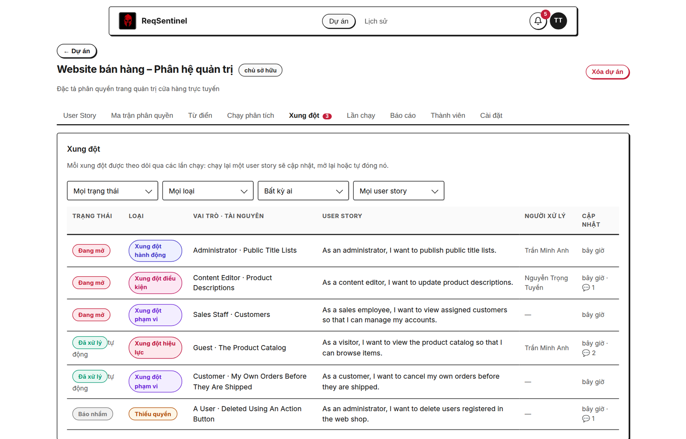

*Hình 19. Tab Xung đột*

### 6.2. Chi tiết và vòng đời xung đột

Khung chi tiết hiển thị giải thích, bằng chứng, user story, lần phát hiện gần nhất (kèm liên kết **xem lần chạy**) và:

- **Chuyển sang:** đổi trạng thái. Các trạng thái:
  - **Đang mở** — mới phát hiện;
  - **Đã ghi nhận** — đã xác nhận là vấn đề thật, đang xử lý;
  - **Đã xử lý** — đã sửa;
  - **Báo nhầm** — không phải lỗi thật (dùng để cải thiện mô hình về sau).

  Đang mở / Đã ghi nhận có thể chuyển sang mọi trạng thái còn lại; Đã xử lý và Báo nhầm chỉ mở lại được về Đang mở.
- **Người xử lý**: giao cho một thành viên có vai trò biên tập hoặc chủ sở hữu.
- **Hoạt động**: dòng thời gian gồm phát hiện, đổi trạng thái, giao việc, bình luận. Mọi thành viên (kể cả người xem) đều bình luận được.

Khi chạy lại phân tích:

- xung đột **Đang mở / Đã ghi nhận** không còn xuất hiện sẽ được **tự động đóng** (Đã xử lý, ghi "tự động");
- xung đột **Đã xử lý** xuất hiện lại sẽ được **tự mở lại**;
- xung đột **Báo nhầm** giữ nguyên đánh giá của bạn.

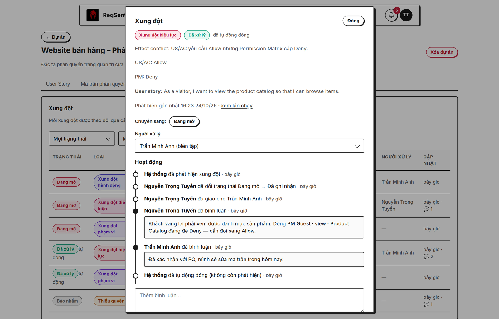

*Hình 20. Chi tiết một xung đột hiệu lực đã được xử lý*

---

## 7. Lần chạy, so sánh và lịch sử

### 7.1. Các lần phân tích của dự án

Tab **Lần chạy** liệt kê mọi lần phân tích: trạng thái (OK / Xung đột), user story, loại xung đột, thời điểm. Bấm **Xem** để mở chi tiết.

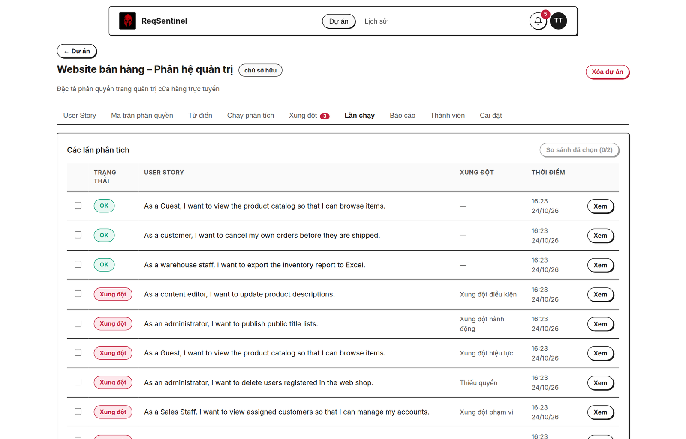

*Hình 21. Tab Lần chạy*

### 7.2. So sánh hai lần chạy

Đánh dấu ô chọn ở **hai** lần chạy rồi bấm **So sánh đã chọn (2/2)**. Hộp thoại chia xung đột thành **Mới**, **Đã hết**,
**Vẫn còn**, và liệt kê **Thay đổi ma trận phân quyền** giữa hai lần chạy — giúp thấy ngay việc sửa ma trận đã giải quyết được gì.

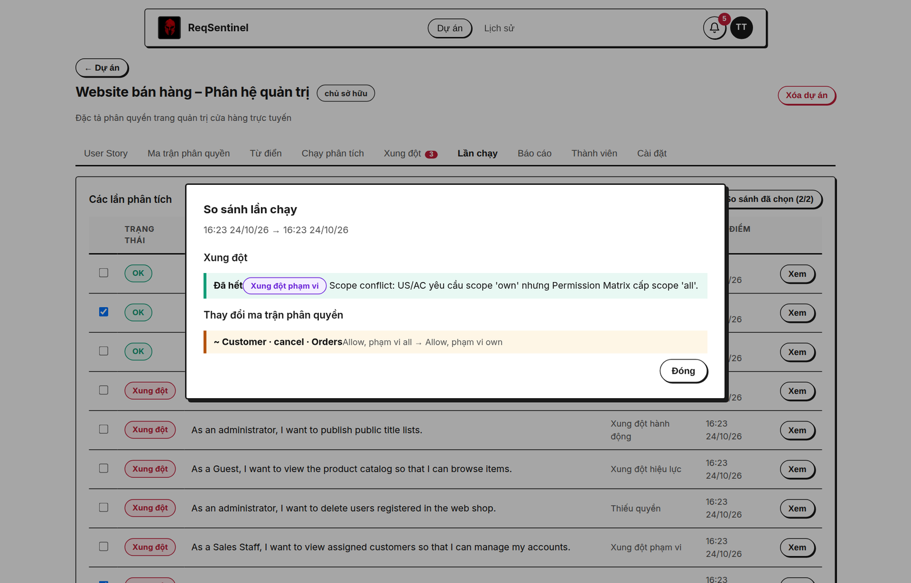

*Hình 22. So sánh hai lần chạy của cùng một user story*

### 7.3. Lịch sử chung

Menu **Lịch sử** trên thanh trên cùng liệt kê mọi lần chạy ở tất cả các dự án bạn có quyền xem.
Bấm **Xem** để mở **Chi tiết lần chạy**: user story, xung đột, trích xuất và tóm tắt.

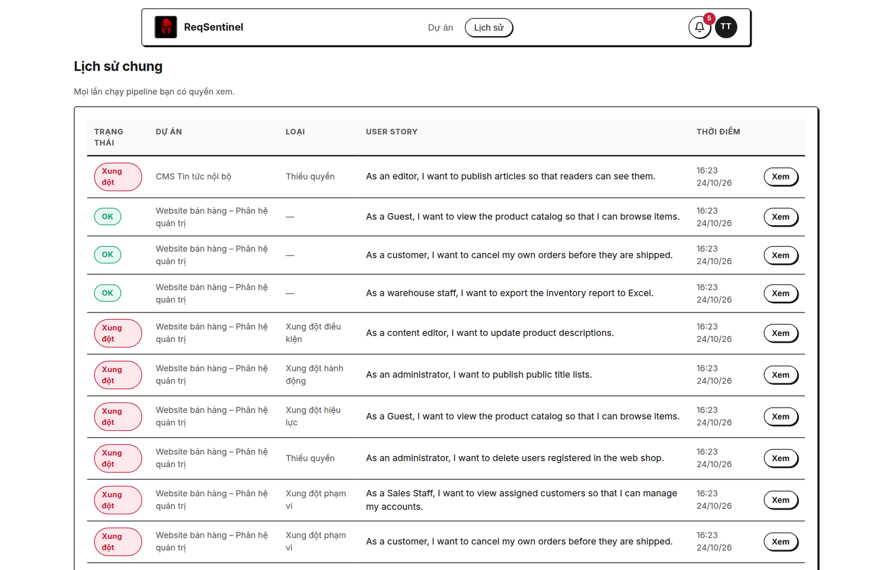

*Hình 23. Trang Lịch sử chung*

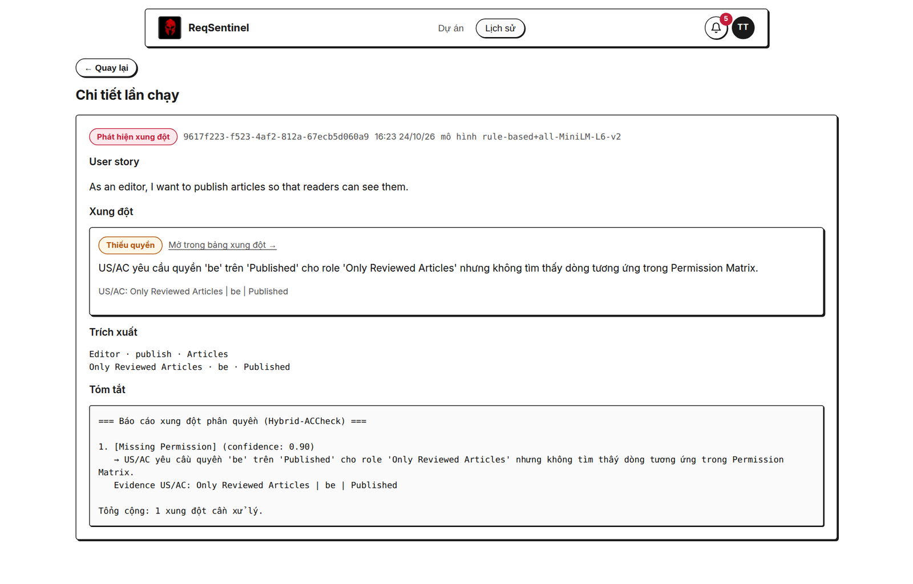

*Hình 24. Chi tiết một lần chạy*

---

## 8. Báo cáo

Tab **Báo cáo** tổng hợp dựa trên **lần chạy gần nhất của mỗi user story**:

- Các chỉ số: **User story đã phân tích**, **Độ nhất quán**, **Xung đột đang mở**, **Quyền Allow không dùng**;
- Biểu đồ **Xung đột theo trạng thái**, **Xung đột theo loại**, **Xung đột đang mở theo vai trò**;
- Nút **Xuất báo cáo Excel** để gửi cho khách hàng hoặc đính kèm tài liệu đặc tả.

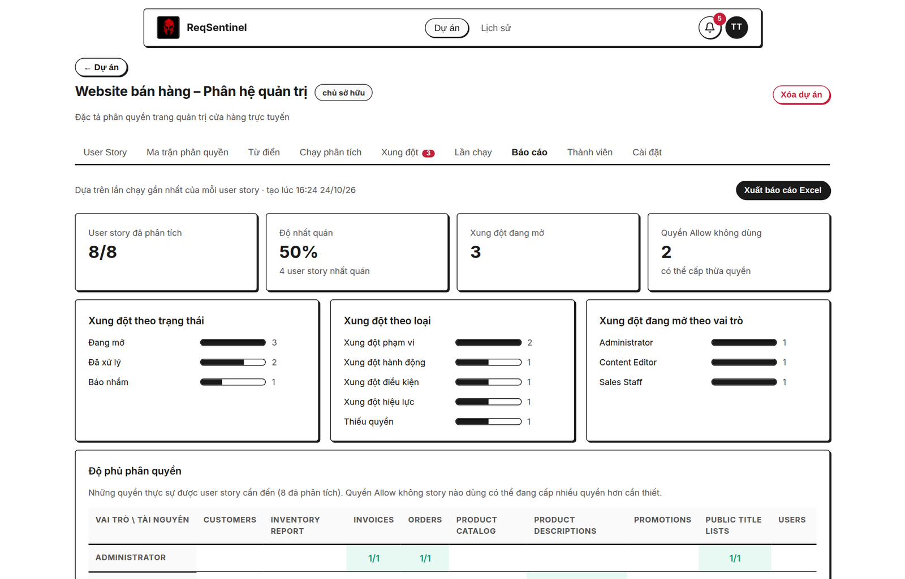

*Hình 25. Tab Báo cáo*

### Độ phủ phân quyền

Bảng **Độ phủ phân quyền** đặt vai trò theo hàng và tài nguyên theo cột. Mỗi ô cho biết trong các quyền Allow của cặp
vai trò–tài nguyên đó, bao nhiêu quyền được ít nhất một user story cần đến (ví dụ `1/1`). Chú thích màu:

- **dùng hết** — mọi quyền Allow đều có user story cần;
- **dùng một phần**;
- **Allow không dùng** — không user story nào cần, **có thể đang cấp thừa quyền**, nên xem lại;
- **Chỉ Deny** — cặp này chỉ có dòng Deny.

Danh sách **Quyền Allow không dùng** bên dưới liệt kê cụ thể các dòng cần xem lại, tiếp theo là bảng trạng thái từng user story.

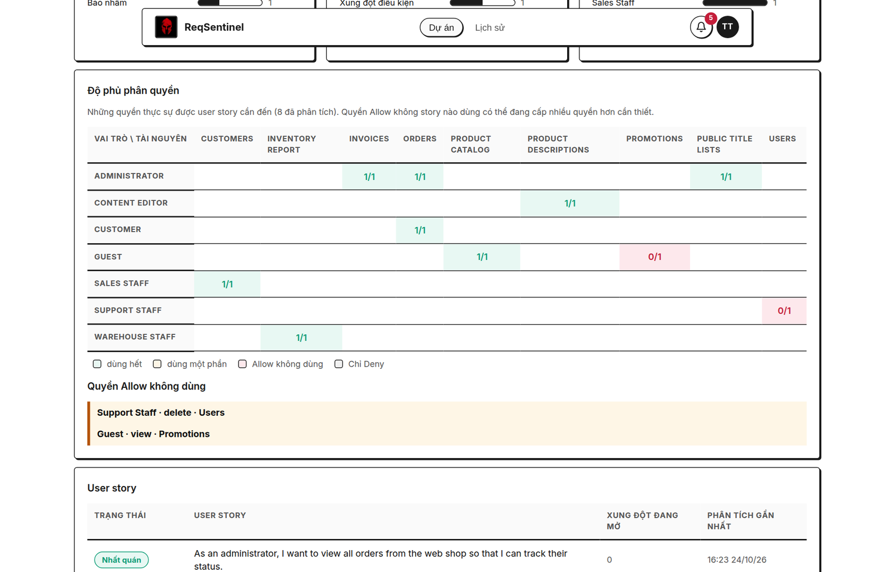

*Hình 26. Bảng độ phủ phân quyền và quyền Allow không dùng*

---

## 9. Thông báo

Chuông trên thanh trên cùng hiển thị số thông báo chưa đọc và cập nhật **ngay lập tức** (không cần tải lại trang);
thông báo mới còn hiện thành một hộp nhỏ ở góc màn hình. Bấm một thông báo để đi tới trang liên quan,
bấm **Đánh dấu đã đọc tất cả** để xóa số chưa đọc.

Bạn nhận thông báo khi:

- được mời vào dự án; có người chấp nhận lời mời của bạn; vai trò của bạn thay đổi; bạn bị gỡ khỏi dự án;
- được giao một xung đột; xung đột bạn được giao hoặc đã tham gia thảo luận đổi trạng thái hoặc có bình luận mới;
- lượt phân tích toàn bộ dự án mà bạn khởi chạy hoàn tất hoặc thất bại.

Ngoài ra hệ thống gửi **email** cho lời mời tham gia dự án và liên kết đặt lại mật khẩu, theo ngôn ngữ trong hồ sơ của người nhận.

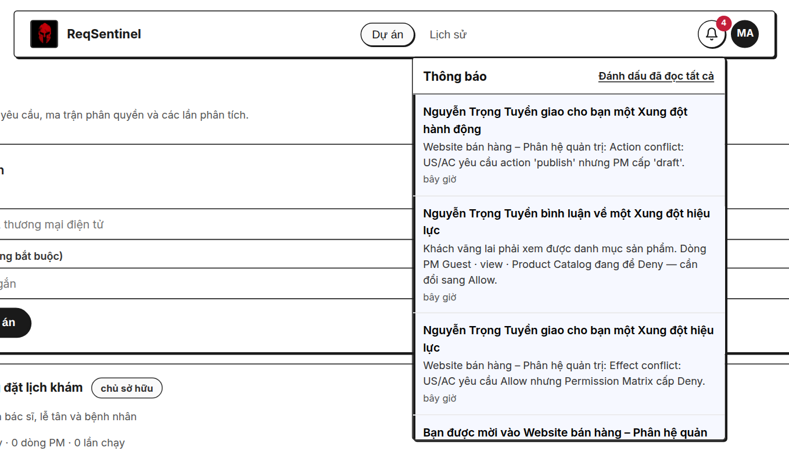

*Hình 27. Danh sách thông báo*

---

## 10. Quản trị hệ thống (chỉ quản trị viên)

Menu **Quản trị** chỉ hiện với tài khoản có vai trò quản trị, gồm ba tab.

### 10.1. Tổng quan

Số người dùng (hoạt động / bị khóa), số dự án, số lần phân tích (7 ngày gần nhất), tỉ lệ lần chạy nhất quán,
số xung đột đang mở; biểu đồ xung đột theo loại, số lần phân tích theo ngày trong 14 ngày.

Phần **Phản hồi cho mô hình**: bấm **Xuất dataset (JSON)** để tải các user story có xung đột đã được BA xem xét
(đã ghi nhận, đã xử lý thủ công hoặc báo nhầm) thành bộ dữ liệu có nhãn, dùng để huấn luyện lại mô hình.

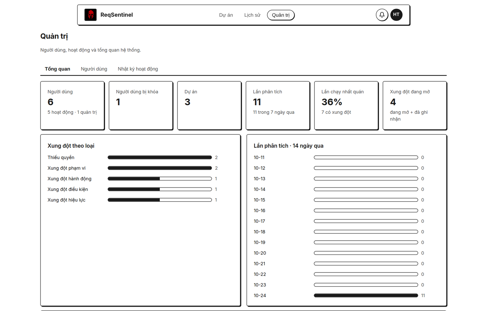

*Hình 28. Tab Tổng quan*

### 10.2. Người dùng

- Tìm theo email/tên, lọc theo vai trò và trạng thái;
- **Người dùng mới**: tạo tài khoản với mật khẩu ban đầu (tối thiểu 8 ký tự) và vai trò;
- Đổi vai trò (quản trị / người dùng) ở cột Vai trò;
- **Khóa** / **Mở khóa**: tài khoản bị khóa bị đăng xuất ngay và không đăng nhập được;
- **Đặt lại mật khẩu**: đặt mật khẩu mới cho người dùng.

Bạn không thể tự hạ quyền hay tự khóa tài khoản của mình, và hệ thống luôn giữ ít nhất một quản trị viên đang hoạt động.

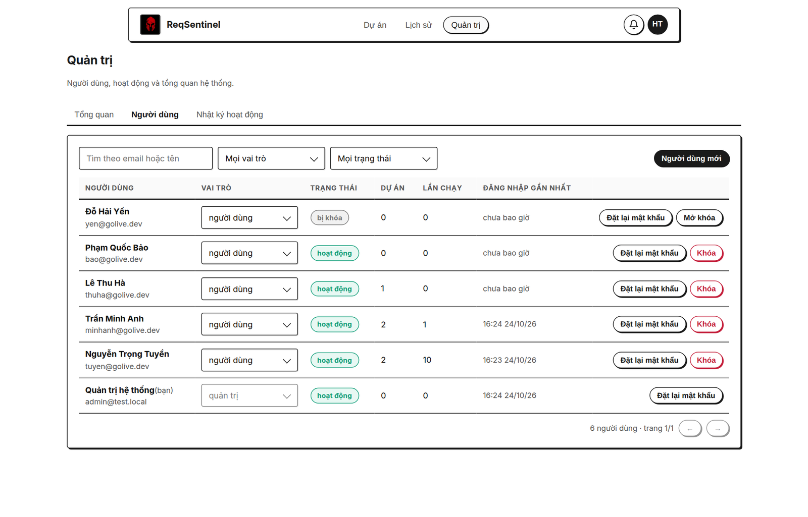

*Hình 29. Tab Người dùng*

### 10.3. Nhật ký hoạt động

Ghi lại các thao tác quan trọng: đăng nhập (kể cả thất bại), tạo/sửa/xóa dự án, nhập Excel, mời/đổi vai trò/gỡ thành viên,
khôi phục ma trận, cập nhật xung đột, chạy phân tích… kèm người thực hiện, đối tượng, chi tiết và địa chỉ IP.
Lọc theo loại hành động ở góc trên.

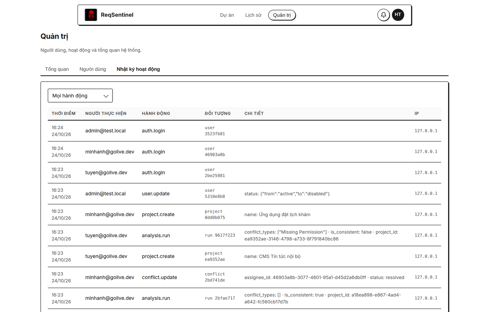

*Hình 30. Tab Nhật ký hoạt động*

---

## 11. Câu hỏi thường gặp

**Tôi không thấy nút Sửa / Xóa / Chạy phân tích.**
Bạn đang có vai trò **người xem** trong dự án. Nhờ chủ sở hữu đổi vai trò sang biên tập.

**Báo "Dịch vụ phân tích không khả dụng".**
Dịch vụ phân tích tạm thời không phản hồi (menu tài khoản cũng hiện chấm đỏ). Dữ liệu không bị mất; thử lại sau ít phút
hoặc báo quản trị viên.

**Liên kết mời báo hết hạn hoặc không còn hiệu lực.**
Lời mời hết hạn sau 7 ngày, hoặc đã bị thu hồi/đã dùng. Nhờ chủ sở hữu gửi lời mời mới.

**Liên kết đặt lại mật khẩu không dùng được.**
Liên kết chỉ có hiệu lực 30 phút và dùng một lần. Yêu cầu liên kết mới ở trang Quên mật khẩu.

**"Lời mời này được gửi tới một địa chỉ email khác."**
Bạn đang đăng nhập bằng tài khoản khác email được mời. Đăng xuất rồi đăng nhập (hoặc đăng ký) bằng đúng email trong lời mời.

**Nhập Excel báo lỗi.**
Chỉ nhận file `.xlsx` tối đa 10 MB, có sheet `UserStories` và/hoặc `PermissionMatrix` như file mẫu. Dùng **Tải mẫu Excel** để có đúng định dạng.

**Một xung đột tôi đã đánh "Đã xử lý" lại hiện "Đang mở".**
Lần chạy mới vẫn phát hiện xung đột đó nên hệ thống tự mở lại. Kiểm tra lại ma trận hoặc user story; nếu đó không phải lỗi thật, đánh **Báo nhầm**.

**Không thể rời dự án / đổi vai trò của chủ sở hữu.**
Dự án phải còn ít nhất một chủ sở hữu. Chuyển vai trò chủ sở hữu cho người khác trước.
